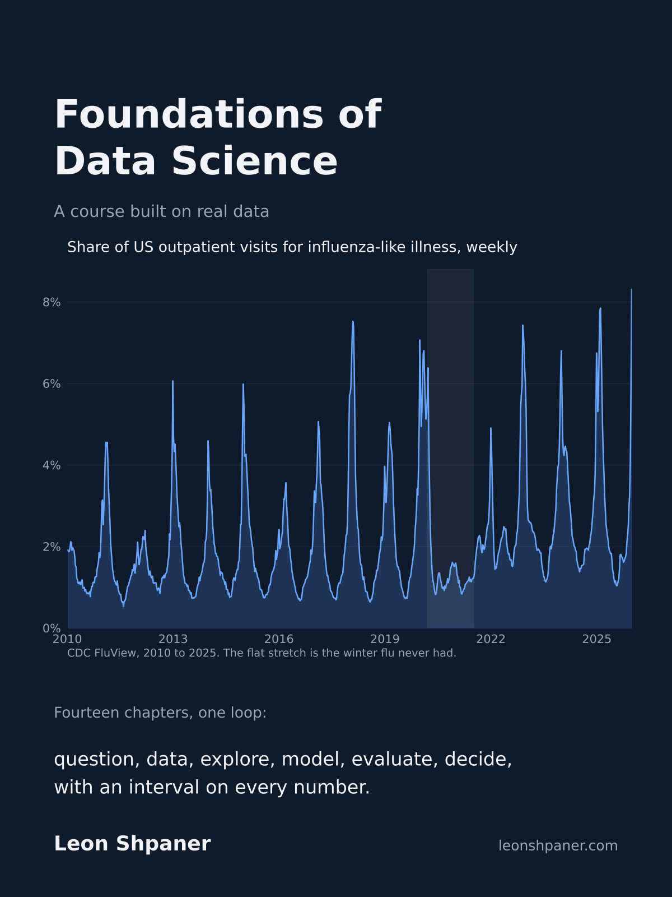

<p align="center">
  <a href="https://lshpaner.github.io/fds_course/"></a>
</p>

# Foundations of Data Science: student materials

Lecture notebooks, assignments, and the project brief for a Foundations of Data Science course, built around one real dataset
(CDC NHANES 2017-2018) that you carry from first contact through a fairness audit, with a flu time series, a hospital contact network,
and a text corpus for the later weeks.

**Read the book:** https://lshpaner.github.io/fds_course/

Author: Leon Shpaner, M.S. All materials are original and owned by the author.

## Chapters

| Chapter | Lecture | Run it |
|---|---|---|
| 1 | [What Data Science Is, and How We Work](https://lshpaner.github.io/fds_course/notebooks/week_01/week_01_intro.html) | [Colab](https://colab.research.google.com/github/lshpaner/fds_course_students/blob/main/notebooks/week_01/week_01_intro.ipynb) |
| 2 | [Data Handling, Joins, and Missing Data](https://lshpaner.github.io/fds_course/notebooks/week_02/week_02_data_handling.html) | [Colab](https://colab.research.google.com/github/lshpaner/fds_course_students/blob/main/notebooks/week_02/week_02_data_handling.ipynb) |
| 3 | [Statistics Recap](https://lshpaner.github.io/fds_course/notebooks/week_03/week_03_statistics_recap.html) | [Colab](https://colab.research.google.com/github/lshpaner/fds_course_students/blob/main/notebooks/week_03/week_03_statistics_recap.ipynb) |
| 4 | [Exploratory Data Analysis](https://lshpaner.github.io/fds_course/notebooks/week_04/week_04_eda.html) | [Colab](https://colab.research.google.com/github/lshpaner/fds_course_students/blob/main/notebooks/week_04/week_04_eda.ipynb) |
| 5 | [Visualization and Communication](https://lshpaner.github.io/fds_course/notebooks/week_05/week_05_visualization.html) | [Colab](https://colab.research.google.com/github/lshpaner/fds_course_students/blob/main/notebooks/week_05/week_05_visualization.ipynb) |
| 6 | [Regression](https://lshpaner.github.io/fds_course/notebooks/week_06/week_06_regression.html) | [Colab](https://colab.research.google.com/github/lshpaner/fds_course_students/blob/main/notebooks/week_06/week_06_regression.ipynb) |
| 7 | [Supervised Learning, Classification](https://lshpaner.github.io/fds_course/notebooks/week_07/week_07_classification.html) | [Colab](https://colab.research.google.com/github/lshpaner/fds_course_students/blob/main/notebooks/week_07/week_07_classification.ipynb) |
| 8 | [Model Evaluation and Tradeoffs](https://lshpaner.github.io/fds_course/notebooks/week_08/week_08_evaluation.html) | [Colab](https://colab.research.google.com/github/lshpaner/fds_course_students/blob/main/notebooks/week_08/week_08_evaluation.ipynb) |
| 9 | [Unsupervised Learning](https://lshpaner.github.io/fds_course/notebooks/week_09/week_09_unsupervised.html) | [Colab](https://colab.research.google.com/github/lshpaner/fds_course_students/blob/main/notebooks/week_09/week_09_unsupervised.ipynb) |
| 10 | [Time Series Analysis](https://lshpaner.github.io/fds_course/notebooks/week_10/week_10_time_series.html) | [Colab](https://colab.research.google.com/github/lshpaner/fds_course_students/blob/main/notebooks/week_10/week_10_time_series.ipynb) |
| 11 | [Social Network Analysis](https://lshpaner.github.io/fds_course/notebooks/week_11/week_11_networks.html) | [Colab](https://colab.research.google.com/github/lshpaner/fds_course_students/blob/main/notebooks/week_11/week_11_networks.ipynb) |
| 12 | [Practical Use of Language Models](https://lshpaner.github.io/fds_course/notebooks/week_12/week_12_language_models.html) | [Colab](https://colab.research.google.com/github/lshpaner/fds_course_students/blob/main/notebooks/week_12/week_12_language_models.ipynb) |
| 13 | [Ethics, Fairness, and Data](https://lshpaner.github.io/fds_course/notebooks/week_13/week_13_fairness.html) | [Colab](https://colab.research.google.com/github/lshpaner/fds_course_students/blob/main/notebooks/week_13/week_13_fairness.ipynb) |
| 14 | [Project Presentations and Course Wrap-Up](https://lshpaner.github.io/fds_course/notebooks/week_14/week_14_presentations.html) | [Colab](https://colab.research.google.com/github/lshpaner/fds_course_students/blob/main/notebooks/week_14/week_14_presentations.ipynb) |

Project: [brief](project/project_brief.md), [rubric](project/rubric.md). Schedule and grading: [course map](docs/course_map.md).

## Running the notebooks

**Colab (no setup).** Use the Colab links above, or open any notebook in `assignments/`; the first cell clones this repo,
installs the requirements, and fetches only the data that notebook needs.

**Locally.** Python 3.11 or 3.12.

```bash
make create_venv && source .venv/bin/activate
make data_gen        # fetch raw data into data/raw/
make preprocess      # build data/processed/nhanes.parquet
make lab
```

## Layout

```
notebooks/      one folder per chapter (week_NN), lecture notebooks
assignments/    one folder per week, homework notebooks
project/        project brief and rubric
docs/           course map
core/           dataset registry and loaders
data_gen.py     fetch raw data (typer CLI)
preprocessing.py cleaning and joins
```

## Data

All public: CDC NHANES 2017-2018, CDC FluView weekly ILI via CMU Delphi Epidata, the SocioPatterns hospital
ward contact network via Netzschleuder, and scikit-learn's 20 Newsgroups. `data/` is empty in this repo;
`make data_gen` or any notebook's setup cell fills it.
